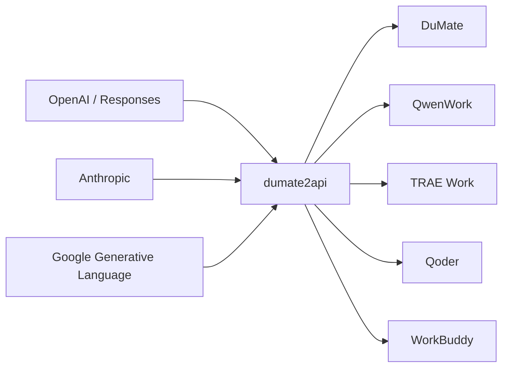

# dumate2api

> 架构与实现细节见 [ARCHITECTURE.md](ARCHITECTURE.md)，完整操作说明见 [用户使用手册](docs/USER_MANUAL.md)。


**五条上游，三协议网关。** 把百度搭子（DuMate）、千问办公、TRAE Work、Qoder、WorkBuddy 统一转换为 **OpenAI / Anthropic / Google 兼容 API**，供 Codex CLI、Claude Code、cc-switch 等客户端使用。

网关默认只监听本机，所有模型端点强制校验 API Key；项目同时提供网页管理端、账号与凭证管理、签到、积分、额度和请求日志。

<p align="center">
  
</p>

## 主要能力

- **OpenAI / Anthropic / Google 兼容**：覆盖 OpenAI Chat Completions、OpenAI Responses、Anthropic Messages 与 Google Generative Language。
- **五通道路由**：通过模型名前缀显式选择上游，未知前缀返回 `400`，不做静默回落。
- **凭证自持**：网关进程内直连上游，不依赖官方桌面程序常驻；Qwen 与 Qoder 的签名逻辑在本地完成。
- **强制鉴权**：管理端签发的 `dmk_...` 密钥或 `DUMATE2API_KEY` 环境密钥才能访问模型端点。
- **管理能力**：账号登录、模型与额度、签到详情、积分流水、用量统计、请求日志、聊天测试台、区域视图。
- **Docker 部署**：单个容器同时运行网关与管理端，前端在镜像构建阶段生成，数据统一持久化到 `./data`。

## 架构



## Docker 部署

推荐使用 Docker Compose。镜像会安装网关依赖、构建 `web/dist`，然后在同一个容器中启动网关与管理端。

```bash
docker compose up -d --build
docker compose ps
```

默认地址：

- 管理端：`http://127.0.0.1:9081`
- 网关：`http://127.0.0.1:9080`

首次启动时，管理端会在容器日志中打印一次 `admin` 初始密码：

```bash
docker compose logs -f dumate2api
```

容器默认共享 `/app/data`，宿主机对应目录为 `./data`。停止服务不会删除账号、Cookie、API Key、日志或管理员状态：

```bash
docker compose down
```

### 自定义端口与数据目录

默认配置可直接运行。需要修改端口、监听地址或数据目录时，创建本地 `.env`：

```bash
# Linux / macOS
cp .env.example .env

# Windows PowerShell
Copy-Item .env.example .env
```

编辑 `.env` 后重新启动：

```bash
docker compose up -d
```

常用 Compose 变量：

| 变量 | 默认 | 说明 |
|---|---|---|
| `DUMATE_BIND_ADDR` | `127.0.0.1` | 宿主机监听地址，默认只允许本机访问 |
| `DUMATE_GATEWAY_PORT` | `9080` | 网关宿主机端口 |
| `DUMATE_ADMIN_PORT` | `9081` | 管理端宿主机端口 |
| `DUMATE_DATA_DIR` | `./data` | 账号、密钥、日志和管理状态的持久化目录 |
| `DUMATE_IMAGE` | `dumate2api:local` | Compose 使用的镜像名 |

不要在没有反向代理、TLS 和访问控制的情况下直接把端口暴露到公网。API Key 是强制要求，但不能替代网络层防护。

### 容器中的账号登录

容器没有图形桌面，需要本机图形浏览器的抓取流程不可用。DuMate 可优先使用管理端的“手动粘贴 Cookie”，或把桌面环境已登录的 `web-accounts.json` 迁移到 `./data`。其他通道优先使用 OAuth、认证文件导入或 Token 粘贴。

## 首次登录与 API Key

1. 打开 `http://127.0.0.1:9081`，用户名使用 `admin`。
2. 从 `docker compose logs` 取得首次启动时打印的随机密码并登录。
3. 在“账号管理”中切换到目标通道，添加账号、完成 OAuth，或导入 Cookie / Token。
4. 在“API Key”页面创建密钥并妥善保存。签发的密钥形如 `dmk_...`。
5. 也可以在 `.env` 中设置固定密钥 `DUMATE2API_KEY=...`，然后执行 `docker compose up -d` 使其生效。

> **鉴权已强制开启。** 除 `/health` 与 `/ping` 外，所有端点都必须带密钥。`DUMATE_REQUIRE_KEY` 已废弃；即使设为 `0`，也只会打印警告，不能关闭鉴权。

网关健康检查：

```bash
curl http://127.0.0.1:9080/health
```

最小请求示例：

```bash
export DUMATE_API_KEY='dmk_...'

curl http://127.0.0.1:9080/v1/chat/completions \
  -H "Authorization: Bearer $DUMATE_API_KEY" \
  -H "Content-Type: application/json" \
  -d '{"model":"model-text","messages":[{"role":"user","content":"hello"}]}'
```

## 通道与模型路由

| 通道 | 模型前缀 | 上游 | 凭证方式 | 官方客户端 |
|---|---|---|---|---|
| 百度搭子（DuMate） | 无前缀，默认 | 网页接口 / 本地 `:8980` | 网页 Cookie；可选桌面登录态 | 否 |
| 千问办公（QwenWork） | `qwen/` | 云端网关，进程内直连 | OAuth Device Flow | 否 |
| TRAE Work | `traework/` | 云端网关，进程内直连 | OAuth | 否 |
| Qoder | `qoder/` | 云端网关，进程内直连 | OAuth Device Flow | 否 |
| WorkBuddy | `workbuddy/` | 腾讯 Copilot 系，国内 / 国际双区域 | 浏览器 OAuth、认证文件导入或 Token 粘贴 | 否 |

| 调用方传的模型名 | 路由到 |
|---|---|
| `model-text`、`glm-5` 等无前缀模型 | 百度搭子 |
| `qwen/pro`、`qwen/flash` | 千问办公 |
| `traework/glm-5.2` | TRAE Work |
| `qoder/gfmodel` | Qoder |
| `workbuddy/<模型 ID>` | WorkBuddy，区域由账号决定 |
| 未知前缀，如 `qwn/pro` | **返回 400，不静默回落** |

WorkBuddy 支持国内与国际区域，实际可用模型以管理端和 `GET /v1/models` 为准。Qoder 零额度时聊天可能挂起，使用前先确认签到与余额；其模型倍率差异较大，调试时优先选择低倍率档。

## 客户端配置

| 客户端 | API 格式 | Base URL | Key | 模型 |
|---|---|---|---|---|
| Claude Code | Anthropic | `http://127.0.0.1:9080`，不要追加 `/v1` | `dmk_...` | `model-text` |
| Codex CLI | OpenAI Responses | `http://127.0.0.1:9080/v1` | `dmk_...` | `model-text` |
| 通用 OpenAI 客户端 | Chat Completions | `http://127.0.0.1:9080/v1` | `dmk_...` | `model-text` |
| Google 客户端 | Generative Language | `http://127.0.0.1:9080` | `dmk_...` | 通过 `/v1beta/models` 获取 |

Codex CLI `config.toml` 示例：

```toml
model_provider = "dumate"
model = "model-text"

[model_providers.dumate]
name = "DuMate local proxy"
base_url = "http://127.0.0.1:9080/v1"
wire_api = "responses"
env_key = "DUMATE_API_KEY"
```

启动 Codex 前设置环境变量：

```powershell
$env:DUMATE_API_KEY = "dmk_..."
```

Claude Code 常用环境变量：

```bash
export ANTHROPIC_BASE_URL='http://127.0.0.1:9080'
export ANTHROPIC_AUTH_TOKEN='dmk_...'
export ANTHROPIC_MODEL='model-text'
```

## API 端点

| 端点 | 协议 / 用途 |
|---|---|
| `POST /v1/chat/completions` | OpenAI Chat Completions |
| `POST /v1/responses`、`POST /responses` | OpenAI Responses，Codex CLI 使用 |
| `POST /v1/messages`、`POST /messages` | Anthropic Messages |
| `GET /v1beta/models` | Google 模型列表 |
| `POST /v1beta/models/{model}:generateContent` | Google Generative Language |
| `GET /v1/models` | 当前网关可用模型列表 |
| `GET /health`、`GET /ping` | 健康检查，无需 API Key |

## 本地运行

要求 Node.js 18 或更高版本。管理端前端源码在 `web/`，`web/dist` 未提交，因此首次本地运行必须先构建：

```bash
corepack enable
pnpm install
pnpm --dir web install
pnpm --dir web run build
```

启动网关：

```bash
pnpm start
```

另开一个终端启动管理端：

```bash
pnpm run admin
```

默认地址同样为网关 `http://127.0.0.1:9080`、管理端 `http://127.0.0.1:9081`。若管理端提示 `web/dist/index.html missing`，说明前端尚未构建。

Windows 日常开发可以使用：

```bat
start-dev.bat
```

该脚本使用网关 `9082`、管理端 `9083`，不会占用 `stable/` 快照常用的 `9080/9081`。

## 管理端

<p align="center">
  
  
  
</p>

<p align="center">
  
</p>

<p align="center"><sub>签到详情：每个账号的当月日历与全年各月汇总，切换月份即可回看。</sub></p>

<p align="center">
  
</p>

<p align="center"><sub>账号管理页：一键签到 / 单账号签到与抽奖 / 跑任务 / 一键抽奖，后台自动轮询的间隔策略如实展示；任务记录并入积分明细的操作流水。</sub></p>

顶栏切换通道，各页面据此显示对应数据。

| 页面 | 回答什么问题 |
|---|---|
| 仪表盘 | 各通道健康、用量、账号状态、即将过期积分 |
| 模型管理 | 有哪些模型、上下文/输出上限、倍率、额度还剩多少 |
| 积分明细 | 积分从哪来、怎么没的；签到详情按月/按年查看 |
| 用量统计 / 请求日志 | 趋势与逐条明细（含每条请求花的积分） |
| API Key / 账号管理 / 聊天测试台 | 签发密钥 / 增删账号跑任务 / 在管理端内调试模型 |

> **五条通道的额度与账本相互独立，不能直接相加**：DuMate 依赖上游账单与余额游标，QwenWork 是积分池，TRAE 按账号计 credits，Qoder 区分订阅与赠送额度，WorkBuddy 按国内 / 国际账号和套餐计算。

## 环境变量

| 变量 | 默认 | 说明 |
|---|---|---|
| `DUMATE2API_HOST` / `DUMATE2API_PORT` | `127.0.0.1` / `9080` | 网关监听地址与端口 |
| `DUMATE2API_KEY` | 空 | 可选的固定网关密钥；与管理端签发的密钥同时有效 |
| `DUMATE_REQUIRE_KEY` | 已废弃 | 不能关闭鉴权；设为 `0` 仅触发启动警告 |
| `DUMATE_ADMIN_HOST` / `DUMATE_ADMIN_PORT` | `127.0.0.1` / `9081` | 管理端监听地址与端口 |
| `DUMATE_ADMIN_GATEWAY_PORT` | `9080` | 管理端读取哪个网关实例的状态 |
| `DUMATE_ADMIN_DATA` | `data` | 管理端数据目录 |
| `DUMATE_DUMATE_SOURCE` | `web` | DuMate 凭证来源；`web` 只用网页凭证，`auto` 为桌面优先并回落网页 |
| `DUMATE_QWENWORK_AUTOSTART` / `DUMATE_TRAEWORK_AUTOSTART` / `DUMATE_QODER_AUTOSTART` | `auto` | 设为 `off` 可关闭对应通道自动启动 |
| `DUMATE_AUTO_CHECKIN_HOUR` / `DUMATE_AUTO_CHECKIN_MINUTE` | `9` / `17` | 每日自动签到时间，两个变量需同时设置 |
| `DUMATE_CORS_ORIGINS` | 空 | 管理端 CORS 白名单；默认为 fail-closed |
| `DUMATE_PROXY` | 空 | 全局出站代理 |

完整变量表与通道协议说明见 [CLAUDE.md](CLAUDE.md) 和 `docs/CHANNEL-*.md`。

## 测试与验证

```bash
npm test            # 离线 Node 单元测试
npm run test:smoke  # 在线冒烟测试，默认访问网关 9080
npm run verify      # 综合验证，按输出确认各脚本的在线依赖
```

常用离线验证：

```bash
node test/verify-qoder-cosy.js
node test/verify-checkin-detail.js
node test/verify-fallback-stream-pipe.js
```

更多脚本见 `test/verify-*.js`。修改对应模块后，先运行相关离线验证，再运行在线冒烟测试。

## 数据与凭证

| 文件 | 内容 | 敏感度 |
|---|---|---|
| `keys.json` | 管理端签发的 API Key，仅保存 SHA-256 | 低 |
| `web-accounts.json` | DuMate 网页账号与 Cookie，Cookie 明文保存 | 高 |
| `qwenwork-accounts.json` | QwenWork OAuth 凭证与 refresh token | 高 |
| `traework-accounts.json` | TRAE Work 凭证与 refresh token | 高 |
| `qoder-accounts.json` | Qoder 凭证与 refresh token | 高 |
| `workbuddy-accounts.json` | WorkBuddy 国内 / 国际账号、Token 与区域信息 | 高 |
| `admin-users.json` / `admin.secret` | 管理员口令与会话密钥 | 高 |

`data/` 已加入 `.gitignore`。不要把 `data/` 提交到 Git、打包进镜像、上传到网盘或放入公开备份。Cookie 和 refresh token 被复制后通常可以直接使用账号额度。

## 安全建议

- 默认只监听 `127.0.0.1`。需要远程访问时，在反向代理后启用 TLS、身份认证和来源限制。
- API Key 仍需按客户端分配，避免所有调用方共用一个长期密钥。
- 停止服务后再备份 `data/`，并限制备份文件权限。
- 定期检查账号状态、额度、请求日志和异常来源 IP。

## 许可证

[MIT](LICENSE)

---

**免责声明**：本项目是独立的第三方开源项目，与百度、阿里（千问办公、Qoder）、字节（TRAE）、腾讯（WorkBuddy）及 Anthropic、OpenAI、Google 等主体无隶属、合作或背书关系。项目通过协议适配与本机凭证互操作，不破解、不绕过任何付费墙或授权机制，不分发上游二进制资产，也不上传用户数据。凭证与日志只保存在本机。上游协议可能变化，积分自动化也可能违反服务条款并导致账号受限，使用风险由使用者自行承担。本项目按“现状”提供，不附带任何明示或暗示担保。
